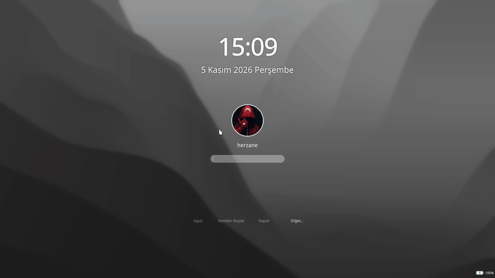

<h1 align="center">WhiteSur-dark-herzane — SDDM Theme</h1>

<p align="center">
  
</p>

<p align="center">
  <strong>English</strong> | <a href="README_TR.md">Türkçe</a>
</p>

<p align="center">
  
  
  
  
</p>

<p align="center">
  A dark, macOS Big Sur inspired SDDM login theme for KDE Plasma 6.
</p>

> [!NOTE]
>
> This theme is split from the
> [WhiteSur-kde](https://github.com/vinceliuice/WhiteSur-kde) project and adapted
> for Plasma 6. It also adds an interactive login screen that **hides after
> 5 seconds of inactivity and wakes on any mouse or keyboard input**.

## Features

Supports all the standard features of an SDDM theme. Additionally:

- The login screen hides after 5 seconds of inactivity.
- Any mouse or keyboard input brings the login screen back.

## Changes in this variant

- Split from the upstream project into a standalone theme.
- KDE Plasma 6 / Qt 6 compatibility.
- Interactive login screen that hides after 5 seconds and wakes on input.

## Requirements

- SDDM
- KDE Plasma 6
- Qt 6
- `org.kde.breeze.components` (provided by Plasma)

## Installation

```bash
git clone https://github.com/herzane52/WhiteSur-dark-herzane.git
cd WhiteSur-dark-herzane
sudo ./install.sh
```

Then select **WhiteSur-dark-herzane** in:

> System Settings → Startup and Shutdown → Login Screen (SDDM)

## Testing the theme

You can preview the theme without installing it. Run the SDDM greeter in test
mode and point it to the theme folder:

```bash
cd WhiteSur-dark-herzane
sddm-greeter-qt6 --test-mode --theme "$PWD"
```

To test the installed copy instead:

```bash
sddm-greeter-qt6 --test-mode --theme /usr/share/sddm/themes/WhiteSur-dark-herzane
```

The greeter opens in a window inside your current desktop session and does not
touch your SDDM configuration. Close the window.

## Uninstall

```bash
sudo ./uninstall.sh
```

## License

This theme is licensed under the **GNU GPL v3**. © 2026 herzane.

This theme is taken and split from the GPL-3.0 licensed
[WhiteSur-kde](https://github.com/vinceliuice/WhiteSur-kde) project.
Copyright: (c) 2014, David Edmundson.
