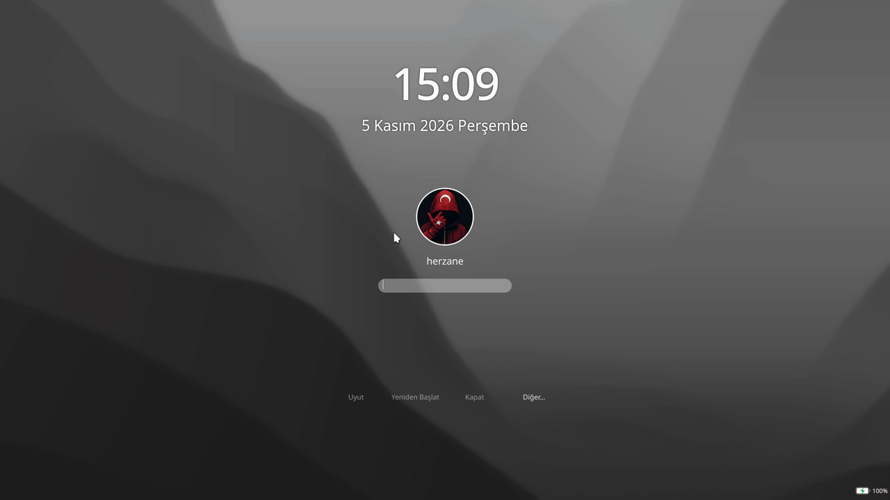

<h1 align="center">WhiteSur-dark-herzane — SDDM Teması</h1>

<p align="center">
  
</p>

<p align="center">
  <a href="README.md">English</a> | <strong>Türkçe</strong>
</p>

<p align="center">
  
  
  
  
</p>

<p align="center">
  KDE Plasma 6 için macOS Big Sur'dan ilham alan koyu bir SDDM giriş ekranı teması.
</p>

> [!NOTE]
>
> Bu tema, [WhiteSur-kde](https://github.com/vinceliuice/WhiteSur-kde)
> projesinden ayrılarak Plasma 6 için uyarlanmıştır. Ayrıca **5 saniye
> hareketsizlikte gizlenen ve herhangi bir fare/klavye girdisinde geri gelen**
> etkileşimli bir giriş ekranı içerir.

## Özellikler

Normal bir SDDM temasının tüm özelliklerini destekler. Ek olarak:

- 5 saniye hareketsizlikte giriş ekranı gizlenir.
- Fare veya klavyeden bir girdi geldiğinde giriş ekranı yeniden görünür.

## Bu varyanttaki değişiklikler

- Ana projeden ayrılarak bağımsız bir tema haline getirildi.
- KDE Plasma 6 / Qt 6 uyumu.
- 5 saniyelik hareketsizlikte gizlenen, fare/klavye girdisinde geri gelen
  etkileşimli giriş ekranı.

## Gereksinimler

- SDDM
- KDE Plasma 6
- Qt 6
- `org.kde.breeze.components` (Plasma tarafından sağlanır)

## Kurulum

```bash
git clone https://github.com/herzane52/WhiteSur-dark-herzane.git
cd WhiteSur-dark-herzane
sudo ./install.sh
```

Ardından şuradan **WhiteSur-dark-herzane** seçin:

> Sistem Ayarları → Başlangıç ve Kapatma → Giriş Ekranı (SDDM)

## Temayı test etme

Temayı kurmadan önizleyebilirsiniz. SDDM giriş ekranını test modunda çalıştırıp
tema klasörünü gösterin:

```bash
cd WhiteSur-dark-herzane
sddm-greeter-qt6 --test-mode --theme "$PWD"
```

Kurulu kopyayı test etmek için:

```bash
sddm-greeter-qt6 --test-mode --theme /usr/share/sddm/themes/WhiteSur-dark-herzane
```

Giriş ekranı mevcut masaüstü oturumunuzda bir pencerede açılır ve SDDM
yapılandırmanıza dokunmaz. Kapatmak için pencereyi kapatın.

## Kaldırma

```bash
sudo ./uninstall.sh
```

## Lisans

Bu tema **GNU GPL v3** lisansı altındadır. © 2026 herzane.

Bu tema, GPL-3.0 lisanslı
[WhiteSur-kde](https://github.com/vinceliuice/WhiteSur-kde) projesinden alınmış
ve ayrılmıştır. Copyright: (c) 2014, David Edmundson.
